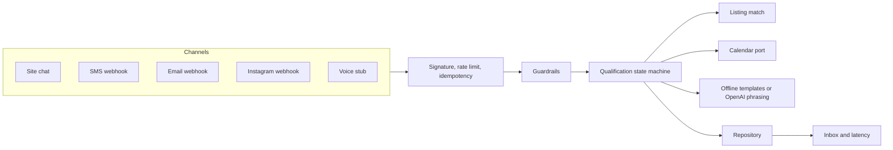

# Harborline Desk

Personal demo by Muhammad Mustafa. It is one qualification and appointment desk for a fictional brokerage, Harborline Realty. Listings, addresses, and leads are synthetic. Nothing here is a client deployment.

## What it does

A lead can write through site chat, a Twilio-shaped SMS webhook, an inbound email payload, or an Instagram webhook. All four call the same state machine. The machine collects budget, area, bedrooms, property type, and timeline, suggests two or three matching listings when it has them, and books a weekday tour on a calendar port. Threads are not capped at three messages. The desk refuses fair-housing steering and legal or financial advice, hands the thread to a person when asked, and treats `STOP` on SMS as an opt-out.

Reply latency is `performance.now()` around each turn. The Latency page shows nearest-rank p50 and p95 for samples stored in this process. If a channel has no samples, the cell is an em dash.

Voice is a stub. `POST /api/webhooks/voice` validates `qualify_lead` and `book_appointment` and does not place a call or book a tour.

## Architecture



Policy decisions (slots, refusals, booking) stay in code. When `OPENAI_API_KEY` is set, the model may rewrite the wording of an ordinary reply. It is not called for refusals, opt-out, or handoff. If the call fails, the template is sent and that reply is marked offline fallback.

Calendar and storage are ports. The default calendar is in-memory, with an async lock and a compare-and-set on slot state. SQLite is selected with `STORAGE_DRIVER=sqlite`. The SQL is ordinary `INSERT ... ON CONFLICT`, so a Postgres executor can sit behind the same repository interface. Cal.com and Google Calendar adapters exist and stay off unless `CALENDAR_PROVIDER` says otherwise.

## Run locally

Requires Node.js 22.

```bash
cp .env.example .env.local
npm install
npm run dev
```

Open `http://localhost:3000`. Chat is `/chat`. The channel simulator is `/simulator`. Inbox is `/dashboard`. Latency is `/metrics`.

Docker:

```bash
docker compose up --build
```

Compose uses the SQLite driver and a named volume. The default `npm run dev` process uses memory, which lives until the process exits.

## Modes

| Mode             | When                                            | What a reply is                                                              |
| ---------------- | ----------------------------------------------- | ---------------------------------------------------------------------------- |
| Offline          | `OPENAI_API_KEY` is empty                       | Rule-based slot extraction and templates. No model call.                     |
| OpenAI           | The key is set and the call returns usable text | Same slot and booking decisions. The model rewrites wording.                 |
| Offline fallback | The key is set and the call times out or fails  | The template from the offline engine. The reply is labeled offline fallback. |

The header reads `Offline engine` or `OpenAI configured`. A reply badge says `Offline`, `OpenAI`, or `Offline fallback`. The badge is the path that produced that reply.

Offline templates vary by turn count. They are not a single script.

## Wiring real channels

No provider account is required to run the demo. The simulator signs payloads with the test secrets in `.env.example`.

SMS, Twilio-shaped `application/x-www-form-urlencoded`:

- URL: `POST /api/webhooks/sms`
- Signature: `X-Twilio-Signature`, HMAC-SHA1 of the public URL plus the sorted form fields, using `TWILIO_AUTH_TOKEN`
- `APP_BASE_URL` must be the public origin Twilio calls, because the signature covers that URL
- Default response is TwiML. Send `X-Harborline-Response: json` for JSON
- `STOP`, `STOPALL`, `UNSUBSCRIBE`, `END`, and `QUIT` opt out. `START` or `UNSTOP` resumes

Email:

- URL: `POST /api/webhooks/email`
- JSON: `messageId`, `from`, `to`, `subject`, `text`
- If `EMAIL_WEBHOOK_SECRET` is set, send `X-Harborline-Signature` as hex HMAC-SHA256 of the raw body

Instagram, Meta-shaped:

- Verify: `GET /api/webhooks/instagram?hub.mode=subscribe&hub.verify_token=...&hub.challenge=...` with `META_VERIFY_TOKEN`
- Events: `POST /api/webhooks/instagram` with `X-Hub-Signature-256: sha256=<hmac of the raw body>` using `META_APP_SECRET`
- The route returns the send shape `{ recipient, message }`. It does not call the Graph API

Calendar:

- `CALENDAR_PROVIDER=memory` is the default
- `calcom` needs `CALCOM_API_KEY` and `CALCOM_EVENT_TYPE_ID`. It calls `GET/POST` on `CALCOM_API_BASE` (default `https://api.cal.com/v2`)
- `google` needs `GOOGLE_CALENDAR_ACCESS_TOKEN` and `GOOGLE_CALENDAR_ID`. This repo does not run an OAuth consent flow. Without a token the adapter refuses to start

Voice stays a stub. See `docs/voice.md`.

## Tests and evals

```bash
npm run lint
npm run typecheck
npm run test:coverage
npm run eval
npm run build
npm run e2e
```

`npm run eval` runs `evals/suite.yaml` in offline mode and exits non-zero under a 100% pass rate. `npm run eval:openai` calls OpenAI for rephrasing when `OPENAI_API_KEY` is set. With no key it prints `skipped` and exits 0. It does not invent model output.

CI runs lint, typecheck, unit and integration coverage, offline evals, build, Playwright (desktop and mobile, plus axe), and Lighthouse mobile scores. The OpenAI job is skipped when the secret is absent. Coverage is gated at 85% lines on `src/domain` (80% branches).

Playwright starts `next start`, so build first.

## Limitations

- Harborline Realty, Cedar Bay, and the 30 listings are fictional.
- In-memory leads and the slot lock live in one Node process. SQLite persists rows across restarts for a single file, not across a fleet.
- The Google adapter does not implement OAuth. Cal.com is off by default.
- The voice webhook does not connect to a telephony vendor.
- Spanish and other-language replies are small template sets, not a translation of the whole desk.
- Transcripts are stored so the inbox can show them. Logs redact email, phone, and SSN. This is not a privacy program.
- Qualification score is `16` points per filled required slot plus a timeline weight (`asap` 20, `30_days` 14, `90_days` 8, `6_months` 4, `browsing` 2), capped at 100. It is not a prediction.
- Latency numbers are only the samples this process recorded.

## License

MIT. See `LICENSE`.
