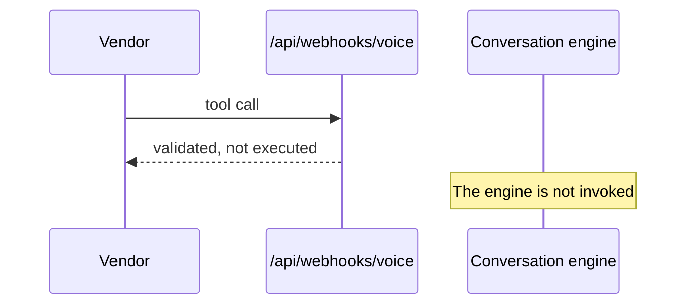

# Voice stub

Voice is not connected. The desk does not place or receive calls.

A future telephony provider (the shapes below match the function-call style used by Vapi and Retell) would POST a tool call to `POST /api/webhooks/voice`. The route validates the body and returns `live: false`, `executed: false`. It does not write a lead, a message, or an appointment.



## qualify_lead

```json
{
  "callId": "call_123",
  "tool": {
    "name": "qualify_lead",
    "arguments": {
      "budgetMax": 700000,
      "area": "Lantern Hill",
      "beds": 3,
      "propertyType": "condo",
      "timeline": "30_days"
    }
  }
}
```

`propertyType` is `condo`, `townhouse`, `single_family`, or `multi_family`. `timeline` is `asap`, `30_days`, `90_days`, `6_months`, or `browsing`.

## book_appointment

```json
{
  "callId": "call_123",
  "tool": {
    "name": "book_appointment",
    "arguments": {
      "leadId": "lead_123",
      "preference": "earliest"
    }
  }
}
```

`preference` is `earliest`, `morning`, or `afternoon`. `slotId` is optional.

If this were enabled, the handler would pass the arguments through the same calendar port as chat, including the in-process lock. That path is not wired. The UI page `/voice` says the same thing.
